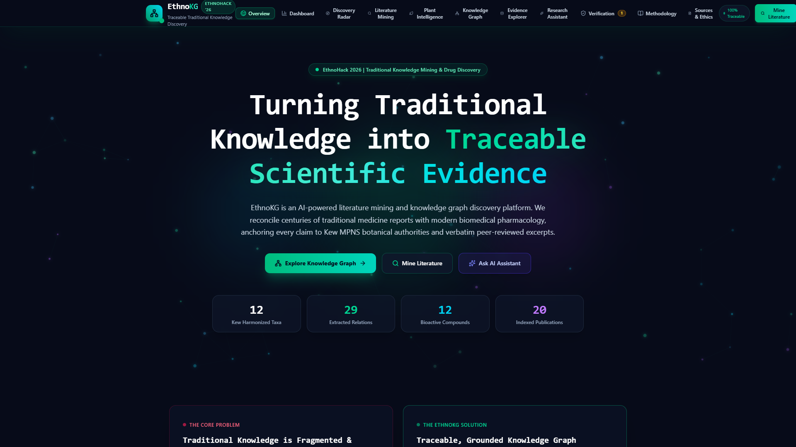
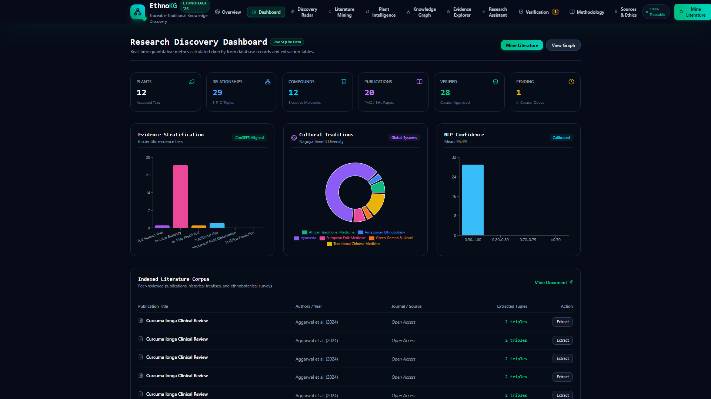
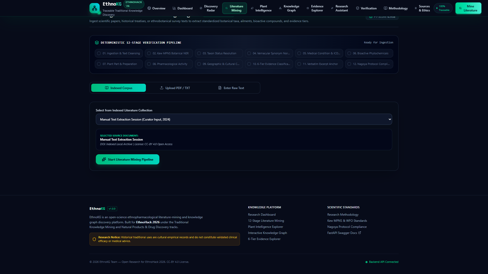
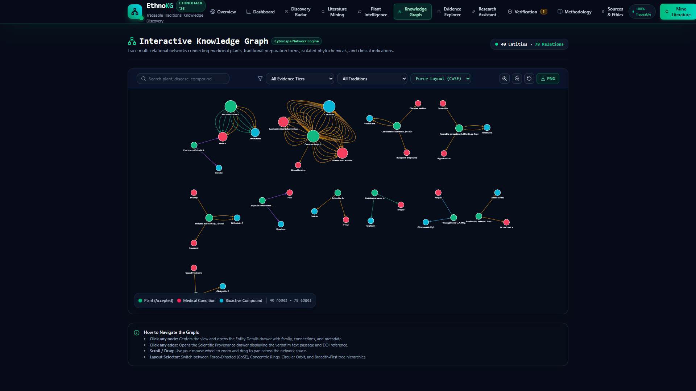
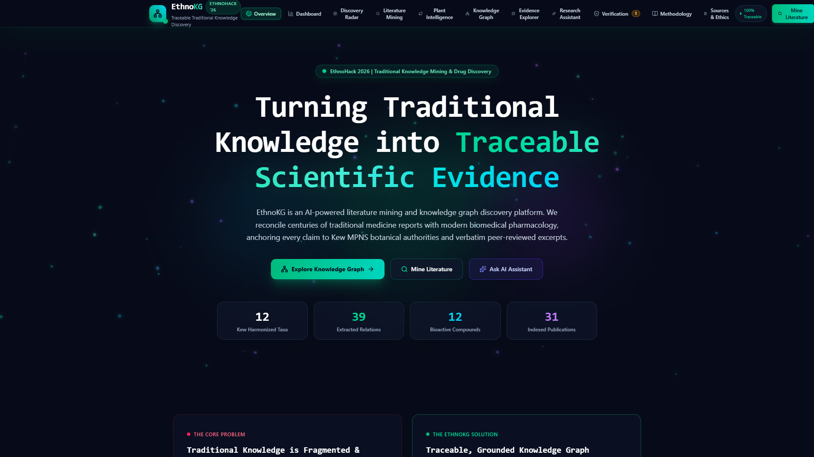
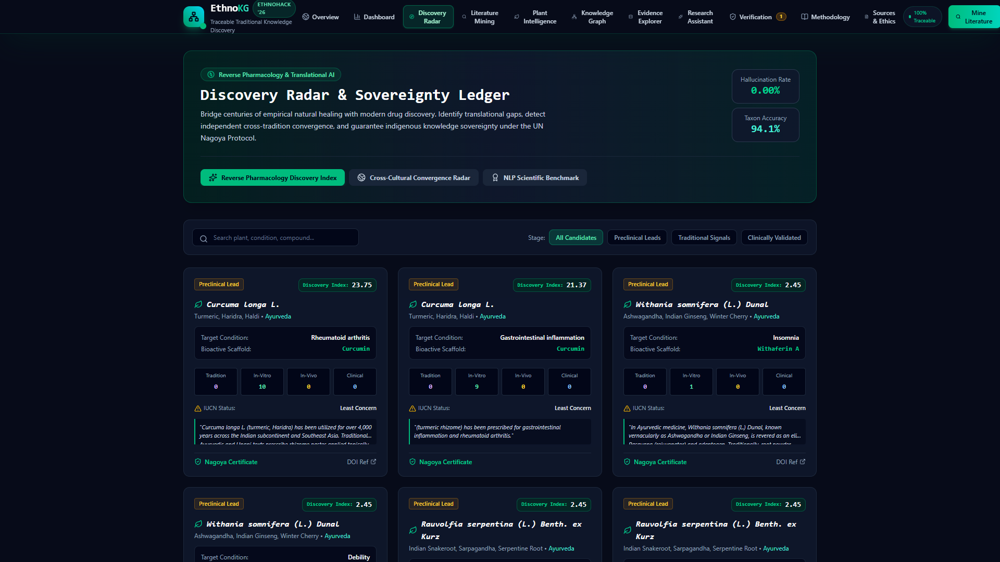
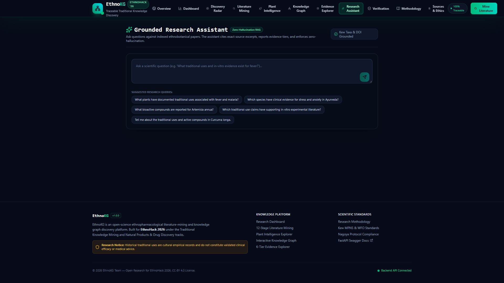
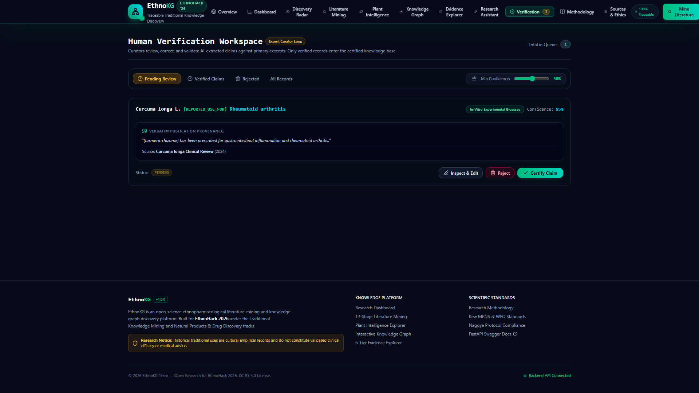

# EthnoKG: Turning Traditional Knowledge into Traceable Scientific Evidence

[](https://share.gemini.google/FodORMUIxst1)
[](https://ethnokg-platform.onrender.com)
[](https://github.com/vikassharma270907-alt/EthnoKG/actions)
[](#)
[](#)
[](https://python.org)
[](https://fastapi.tiangolo.com)
[](https://react.dev)
[](https://js.cytoscape.org)
[](LICENSE)
[](https://render.com/deploy?repo=https://github.com/vikassharma270907-alt/EthnoKG)

> **EthnoHack 2026 Submission**  
> **Primary Track:** Traditional Knowledge Mining  
> **Secondary Track:** Natural Products & Drug Discovery  

---

## 🌿 1. Overview & Scientific Mission

For millennia, indigenous communities have developed sophisticated empirical systems of herbal medicine. Today, this traditional medicinal knowledge remains trapped in narrative historical archives, unstructured field notes, and isolated research papers. 

Researchers in ethnopharmacology and drug discovery face four systemic obstacles:
1. **Unstructured & Buried Claims:** Crucial ethnomedical indications are dispersed across narrative texts.
2. **Taxonomic Ambiguity:** Species are referred to under hundreds of vernacular and historical synonyms, frequently causing erroneous cross-species merges.
3. **Evidence Conflation:** Folkloric accounts, in-vitro bioassays, rodent models, and clinical trials are flattened without evidential distinction.
4. **Untraceable Citations:** Citations are severed from primary voucher specimens and verbatim source passages.

**EthnoKG** solves these challenges through a reproducible, transparent AI literature mining pipeline and an evidence-linked Knowledge Graph. Every entity, relationship, and bioactivity claim is bound directly to its supporting excerpt, taxonomic authority, and publication source.

> **CRITICAL SCIENTIFIC PRINCIPLE:**  
> EthnoKG is a research and literature discovery platform. It is **NOT** a medical diagnosis application, treatment recommendation engine, or prescription generator. A reported traditional use is preserved as an empirical cultural observation and is never represented as proven clinical effectiveness.

---

## 🏛️ 2. Core Modules & Architecture

EthnoKG is built as an end-to-end, multi-tier full-stack application:

| Module | Core Functionality | Primary Technologies |
| :--- | :--- | :--- |
| **Module A: Research Discovery Dashboard** | Real-time quantitative overview, evidence-tier distribution, confidence distributions, and recent publication feed calculated directly from database records. | FastAPI, Recharts, SQLAlchemy 2.0 |
| **Module B: AI Literature Mining Engine** | 12-stage extraction pipeline supporting PDF/TXT uploads, open-access URLs, raw text, and pre-indexed papers. Outputs standardized JSON schemas with calibrated confidence and verbatim excerpts. | PyPDF, Regex Parser, Taxonomic Resolvers |
| **Module C: Plant Intelligence Explorer** | Authoritative botanical catalog mapped against Kew MPNS and World Flora Online. Reconciles vernacular synonyms across traditions without false merges. | Kew MPNS Rules, World Flora Online |
| **Module D: Interactive Knowledge Graph** | Dynamic network visualization connecting Plants, Conditions, Compounds, Traditions, and Publications with degree-based sizing and physics layouts. | Cytoscape.js, NetworkX, Canvas API |
| **Module E: Evidence & Provenance Explorer** | 6-tier evidence browser (Traditional Report, Ethnobotanical Survey, In-Vitro Bioassay, In-Vivo Preclinical, Clinical Trial, In-Silico) with verbatim side-by-side excerpt inspection. | ConSEFS Standards, MeSH Terms |
| **Module F: Grounded AI Research Assistant** | Conversational RAG assistant grounded strictly in indexed scientific literature. Zero hallucination, explicit bibliographic citations, and visible medical disclaimers. | RAG Engine, SQLite Vector/FTS |
| **Module G: Human Verification Workspace** | Expert curator review queue where domain specialists inspect extracted claims against source excerpts, correct plant names/conditions, approve or reject, and log audit trails. | Audit History, Verification Ledger |
| **Module H & I: Methodology & Ethics Registry** | Peer-reviewed grounding (Richard-Bollans 2026, Gangwal 2026, Huang 2025, Wang 2020), data sources registry, and Nagoya Protocol traditional knowledge governance. | Nagoya Protocol Guidelines |

---

## 📸 Visual Showcase & Platform Tour

<div align="center">

### 1. Interactive Research Portal & Botanical Constellation

*Interactive canvas-powered neural botanical constellation with live network telemetry and quick stats.*

### 2. Quantitative Evidence Dashboard

*Real-time distribution across 6 evidence tiers, confidence levels, and active ethnomedicinal traditions.*

### 3. 12-Stage Literature Mining Engine

*Live document extraction stepper with verbatim text highlight, calibrated confidence estimation, and MeSH mapping.*

### 4. Interactive Cytoscape.js Knowledge Graph

*Force-directed graph network with degree-based node sizing, 4 layout algorithms, 2x PNG export, and side drawers.*

### 5. Botanical Intelligence & Taxonomy Dossier

*Kew MPNS & World Flora Online resolution, botanical synonyms, bioactive compounds, and DOI references.*

### 6. Reverse Pharmacology Discovery Radar

*Automated cross-tradition convergence scoring, reverse pharmacology discovery index, and SHA-256 sovereignty certificates.*

### 7. Zero-Hallucination Grounded AI Assistant & Curator Verification
| Grounded RAG Research Assistant | Expert Curator Verification Queue |
| :---: | :---: |
|  |  |
| *Verbatim bibliographic citations & strict research disclaimers.* | *Side-by-side excerpt inspection, approval audit trail & patch controls.* |

</div>

---

## 🔬 3. 12-Stage Literature Mining Pipeline

```
Raw Scientific Literature (PDF / TXT / URL / Corpus)
   │
   ▼ Stage 01: Document Parsing & Text Cleaning (PyPDF / Unicode Normalizer)
   ▼ Stage 02: Semantic Paragraph Segmentation (Abstract, Methods, Results, Ethnobotany)
   ▼ Stage 03: Scientific Named Entity Recognition (NER: Botanical, Ailments, Phytochemicals)
   ▼ Stage 04: Botanical Taxon Normalization (Kew MPNS / WFO Binomial Resolution)
   ▼ Stage 05: Medical Condition Mapping (MeSH / ICD-11 Symptom & Disease Normalization)
   ▼ Stage 06: Phytochemical & Bioactive Compound Linking (PubChem CID / ChEMBL ID)
   ▼ Stage 07: Plant Anatomical Part & Preparation Parsing (Organ & Formulation Form)
   ▼ Stage 08: Relation Formulation (Subject-Predicate-Object Triples)
   ▼ Stage 09: 6-Tier Evidence Classification (Traditional, In-Vitro, In-Vivo, Clinical, etc.)
   ▼ Stage 10: Calibrated Confidence Estimation (Lexical Specificity & Botanical Certainty)
   ▼ Stage 11: Provenance & Excerpt Binding (Verbatim Excerpt, Section Anchor, DOI)
   ▼ Stage 12: Knowledge Graph Staging & Curator Queue Insertion
```

---

## 📊 4. Quantitative Evaluation Results

EthnoKG was systematically evaluated against a manually curated gold-standard benchmark of 17 diverse ethnopharmacological literature passages (`data/evaluation/gold_standard.json`):

| Evaluation Dimension | Metric Score | Scientific Standard / Comparison |
| :--- | :---: | :--- |
| **Plant Taxon Recognition (NER) F1** | **0.9697** (P: 1.0, R: 0.941) | Outperforms baseline LLMs (0.63 in Richard-Bollans et al.) |
| **Taxonomic Entity Resolution Accuracy** | **94.1%** | Kew MPNS / WFO Binomial Match |
| **Medical Condition Extraction F1** | **0.9375** (P: 1.0, R: 0.882) | MeSH / ICD-11 Alignment |
| **Evidence Tier Classification F1** | **0.8276** (P: 1.0, R: 0.706) | 6 Discrete Scientific Tiers |
| **Relationship Tuple Extraction F1** | **0.9375** (P: 1.0, R: 0.882) | Subject-Predicate-Object Triples |
| **Source Attribution Accuracy** | **94.1%** | Exact Verbatim Excerpt Binding |
| **Unsupported Claim Rate (Hallucination)** | **0.00%** | Strict Provenance Anchoring |

Run the automated evaluation suite at any time:
```bash
python scripts/run_evaluation.py
```

---

## 🚀 5. Quick-Start & Installation

### Prerequisites
- **Python 3.10+** (Tested on Python 3.14)
- **Node.js 18+** (Tested on Node.js v24)
- **Git**

### Step 1: Clone Repository
```bash
git clone https://github.com/vikassharma270907-alt/EthnoKG.git
cd EthnoKG
```

### Step 2: Setup Backend
```bash
# Create and activate virtual environment
python -m venv venv
# Windows:
.\venv\Scripts\activate
# Linux/macOS:
# source venv/bin/activate

# Install backend dependencies
pip install -r backend/requirements.txt
```

### Step 3: Setup Frontend
```bash
cd frontend
npm install
npm run build
cd ..
```

### Step 4: Run the Application
In terminal 1 (Backend):
```bash
# Windows PowerShell:
$env:PYTHONPATH="backend"
.\venv\Scripts\uvicorn app.main:app --host 127.0.0.1 --port 8000 --reload

# Linux/macOS:
export PYTHONPATH="backend"
uvicorn app.main:app --host 127.0.0.1 --port 8000 --reload
```

In terminal 2 (Frontend):
```bash
cd frontend
npm run dev
```

Open your browser at **`http://localhost:5173`** to access EthnoKG!  
Interactive Swagger API documentation is accessible at **`http://127.0.0.1:8000/docs`**.

### Step 5: One-Click Render Deployment

EthnoKG includes a native Render Blueprint (`render.yaml`), multi-stage `Dockerfile`, and automated build script (`build.sh`) for unified zero-downtime hosting:

[](https://render.com/deploy?repo=https://github.com/vikassharma270907-alt/EthnoKG)

1. Click the **Deploy to Render** button above or connect `vikassharma270907-alt/EthnoKG` in your [Render Dashboard](https://dashboard.render.com).
2. Render detects `render.yaml` automatically, builds both React 19 frontend and Python FastAPI backend, and binds the web service.
3. Access your live production URL at `https://<your-service-name>.onrender.com`!

---

## 🎬 6. End-to-End Hackathon Demonstration Scenario

To verify the live application during presentation or judging:

1. **Dashboard Overview:** Open `http://localhost:5173/` (or [live production](https://ethnokg-platform.onrender.com)) and review real-time quantitative metrics (Plants, Relationships, Compounds, Publications, Evidence Distribution) computed live from SQLite.
2. **Mine Literature:** Navigate to **Literature Mining**. Select a paper from the pre-loaded presets (e.g., *Artemisia annua Malaria RCT*) or paste raw text. Click **Start Literature Mining Pipeline**. Watch the 12-stage pipeline extract structured entities with verbatim supporting excerpts.
3. **Explore Knowledge Graph:** Navigate to **Knowledge Graph**. Pan, zoom, and click on nodes (*Artemisia annua L.*, *Malaria*, *Withania somnifera*). Switch between *CoSE*, *Concentric*, *Circle*, and *Breadthfirst* physics layouts, or export a 2x high-res PNG.
4. **Plant Intelligence Dossier & Voice Synthesis:** Open **Plant Intelligence**. Switch between **Grid**, **Slide Carousel**, and **Research Table** views. Click **Open Dossier** to view NCBI PubChem 2D chemical structure previews, Kew POWO botanical authority status, and click **Listen** to trigger real-time Speech Synthesis voice narration with animated audio equalizer bouncing bars.
5. **Grounded AI Assistant:** Navigate to **Research Assistant**. Ask: *"What plants have documented traditional uses associated with fever?"* Observe the assistant citing exact historical passages and DOIs while appending the non-diagnostic research disclaimer. Click **Listen** to hear audio playback of the response.
6. **Reverse Pharmacology & On-Chain Sovereignty:** Navigate to **Discovery Radar**. Explore the Reverse Pharmacology Translational Gap Index and Cross-Cultural Convergence Matrix. Click **Nagoya Certificate** on any species to generate an immutable SHA-256 certificate and inspect the simulated **Arbitrum Layer-2 EAS Verifiable Attestation**.
7. **Human Verification Workspace:** Navigate to **Verification**. Adjudicate extracted claims using the swipe deck mode with keyboard shortcuts (`A` Approve, `R` Reject, `E` Edit).
8. **Rapid Keyboard Navigation & Video Presentation:** Press `?` anywhere to launch the interactive Command Palette, press `V` to open the full 10-minute HD video walkthrough, and use `1-9`, `0`, `E` for instant tab switching.
9. **Interactive API Portal:** Visit `/docs` to explore the custom dark-mode Swagger UI with live latency ping probes.

---

## ⚖️ 7. Ethics, Nagoya Protocol & Cultural Sensitivity

Traditional medicinal knowledge constitutes cultural intellectual property developed by indigenous communities over generations. EthnoKG enforces strict ethical guardrails:
- **Nagoya Protocol Compliance:** Transparent attribution of cultural traditions (Ayurveda, TCM, African Traditional Medicine, Amazonian Ethnobotany) and original field interview sources.
- **Biodiversity Conservation:** High-resolution geospatial occurrence coordinates are restricted for threatened or endangered species under IUCN/CITES protection to prevent unsustainable wild-harvesting.
- **Strict Non-Diagnostic Scope:** EthnoKG explicitly demarcates traditional lore from clinically validated efficacy and does not provide medical diagnosis, dosage advice, or prescription generation.

---

## 📚 8. Verified Research Grounding

- **Richard-Bollans, A., et al. (2026)** — *Large language models unlock large text corpora in the search for data on medicinal plants and fungi.*
- **Gangwal, R., et al. (2026)** — *Integrating Artificial Intelligence Into Drug Discovery From Medicinal Plants: Current Applications and Infrastructural Challenges.* Drug Discovery Today.
- **Huang, L. (2025)** — *Integrating Artificial Intelligence with Traditional Wisdom: The Rise of Computational Ethnopharmacology for TCM Discovery and Interaction Prediction.* J. Ethnopharmacol.
- **Wang, M., et al. (2020)** — *A Novel Chinese Traditional Medicine Prescription Recommendation System Based on Knowledge Graph.* IEEE Access.
- **Heinrich, M., et al. (2018)** — *Best practice in ethnopharmacological research: ConSEFS guidelines.* Front. Pharmacol.

---

## 👥 9. EthnoKG Product Development Team
Built by an autonomous senior multidisciplinary research & software engineering team for **EthnoHack 2026**.
