# EthnoKG System Architecture & Engineering Specification

## 1. High-Level Architecture Diagram

```mermaid
flowchart TD
    subgraph DataIngestion ["Data Sources & Ingestion Layer"]
        A1["Open Access Literature (PMC, CORE)"]
        A2["Biodiversity & Herbaria (BHL, GBIF)"]
        A3["User Document Upload (PDF / TXT)"]
        A4["Manual Scientific Excerpts"]
    end

    subgraph ExtractionPipeline ["12-Stage Literature Mining Engine"]
        B1["Text Extraction & Cleaning (PyMuPDF / Regex)"]
        B2["Paragraph & Context Segmentation"]
        B3["Scientific Named Entity Recognition (NER)"]
        B4["Taxonomic Entity Resolution (MPNS / WFO Rules)"]
        B5["Medical Condition & Symptom Normalization"]
        B6["Bioactive Compound & Part Identification"]
        B7["Relation Extraction (S-P-O Triples)"]
        B8["6-Tier Evidence Classification"]
        B9["Calibrated Confidence Scoring"]
    end

    subgraph DataStorage ["Knowledge Base & Persistence Layer"]
        C1[("Relational SQLite / PostgreSQL<br/>Core Entities & Metadata")]
        C2[("In-Memory NetworkX Graph<br/>Multi-hop Traversal & Subgraph API")]
        C3[("Document & Excerpt Provenance Store")]
    end

    subgraph Verification ["Human-in-the-Loop Governance"]
        D1["Pending Extractions Queue"]
        D2["Curator Review & Correction Interface"]
        D3["Audit History & Attribution Ledger"]
    end

    subgraph APIServices ["FastAPI Application Services"]
        E1["Dashboard & Analytics Service"]
        E2["Entity Explorer Service (Plants/Compounds/Conditions)"]
        E3["Graph Query & Subgraph Extraction Service"]
        E4["Verification & Provenance Service"]
        E5["Grounded RAG Assistant Engine"]
    end

    subgraph FrontendApp ["Scientific Research UI (React + Vite + Tailwind)"]
        F1["Research Discovery Dashboard"]
        F2["AI Literature Mining Workspace"]
        F3["Plant Intelligence Explorer"]
        F4["Interactive Knowledge Graph (Cytoscape.js)"]
        F5["Evidence & Provenance Inspector"]
        F6["Grounded AI Research Assistant"]
        F7["Human Verification Workspace"]
    end

    DataIngestion --> ExtractionPipeline
    ExtractionPipeline --> Verification
    Verification --> DataStorage
    ExtractionPipeline --> DataStorage
    DataStorage <--> APIServices
    APIServices <--> FrontendApp
```

---

## 2. Component Breakdown

### 2.1 Backend Core (`backend/app/`)
- **`core/config.py`**: Configuration management using `pydantic-settings` with environment variable loading.
- **`core/database.py`**: SQLite database engine setup, connection pooling, and session factories with SQLAlchemy 2.0.
- **`models/`**: Declarative ORM models representing Plants, Synonyms, Conditions, Compounds, Preparations, Parts, Publications, Relationships, and Verification Logs.
- **`schemas/`**: Strict Pydantic models for request/response serialization, validation, and JSON-Schema enforcement.
- **`services/`**:
  - `document_service.py`: Document upload handling, text extraction from PDF/TXT, and citation metadata extraction.
  - `extraction_service.py`: 12-stage extraction pipeline with hybrid botanical/biomedical NLP algorithms and LLM fallbacks.
  - `graph_service.py`: NetworkX graph management, building bipartite and multi-entity networks, neighborhood subgraph generation, and Cytoscape JSON serialization.
  - `assistant_service.py`: Retrieval-Augmented Generation (RAG) assistant with strict grounded citation generation.
  - `verification_service.py`: Human curation approval/rejection workflows and audit logging.

### 2.2 Extraction Pipeline Architecture
The literature mining engine follows a 12-stage sequential pipeline:
1. **Text Normalization**: Strips PDF hyphenations, artifacts, non-Unicode characters, and normalizes botanical abbreviations.
2. **Segmentation**: Splits texts into coherent semantic passages (abstract, ethnobotanical survey tables, results, discussion).
3. **Plant Entity Detection**: Matches binomials (e.g., *Artemisia annua L.*) and vernacular names against botanical lexicons.
4. **Synonym Harmonization**: Maps vernacular and historical synonyms to accepted taxonomic binomials (using Kew MPNS / WFO standards).
5. **Medical Condition Mapping**: Extracts symptoms, traditional ailments, and disease entities.
6. **Compound & Phytochemical Identification**: Identifies bioactive constituents (e.g., artemisinin, curcumin, withaferin A).
7. **Preparation & Plant Part Extraction**: Extracts specific anatomical parts (leaf, root, bark, aerial parts) and preparation methods (decoction, infusion, poultice, extract).
8. **Relation Formulation**: Assembles subject-predicate-object triples with contextual qualifiers.
9. **Evidence Tier Classification**: Assigns claims to one of six rigorous scientific tiers (Traditional Use, Ethnobotanical Observation, In-Vitro, In-Vivo Preclinical, Clinical Trial, In-Silico).
10. **Confidence Estimation**: Computes confidence based on lexical specificity, syntactic proximity, and botanical validation.
11. **Provenance Anchoring**: Links every extracted field to the exact text excerpt, page/section, document ID, and DOI.
12. **Graph Staging**: Inserts unverified records into the staging queue for curator inspection.

---

## 3. Technology Choices & Justification

| Layer | Chosen Technology | Rationale |
| :--- | :--- | :--- |
| **Frontend Framework** | React 19 + Vite + TypeScript | Lightning-fast build times, strict type safety, modular component architecture, and zero Windows toolchain friction. |
| **Graph Visualization** | Cytoscape.js | High-performance canvas-based network visualization with built-in physics layouts (COSE/cola), edge curving, dynamic node styling, and event handling. |
| **Styling & Icons** | Tailwind CSS + Lucide Icons | Clean scientific SaaS aesthetic (Navy/Slate/Emerald), consistent spacing, responsive grid, zero runtime styling overhead. |
| **Backend Framework** | FastAPI (Python 3.14+) | Async I/O, automatic OpenAPI docs, native Pydantic validation, rapid development. |
| **Database & Graph** | SQLite + SQLAlchemy 2.0 + NetworkX | Zero-configuration local database that runs reliably on any machine without requiring external daemon setup; NetworkX provides graph algorithms and subgraph extraction. |
| **Document Processing** | PyPDF + Custom Regex Segmenter | Robust offline document parsing without external API dependencies. |
