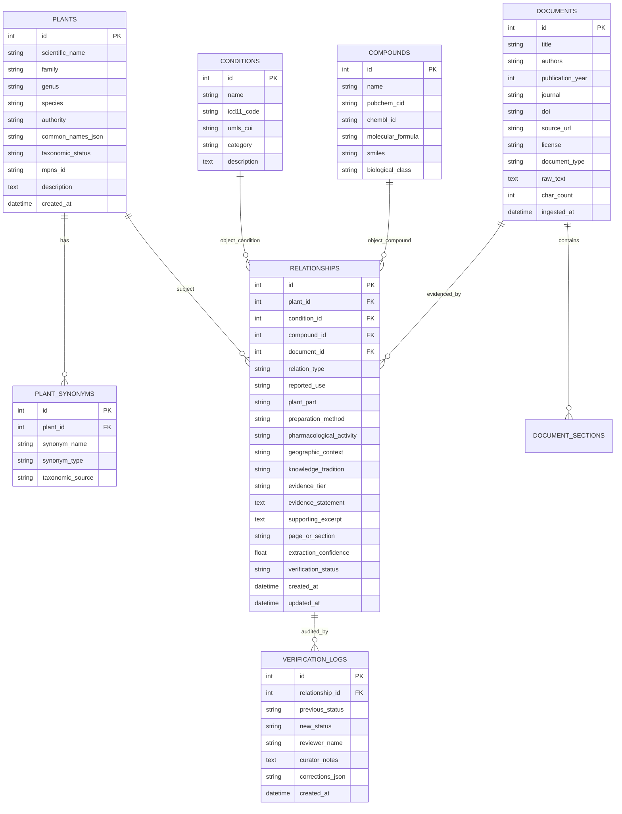

# EthnoKG Database Schema & Relational Specifications

## 1. Entity-Relationship Overview

The database design reflects the ethnopharmacological research ontology, maintaining strict referential integrity, bidirectional relationships, and immutable provenance.

---

## 2. Table Specifications

### 2.1 `plants`
Primary repository of botanical taxa verified against Kew MPNS and World Flora Online standards.
- `id` (INTEGER, Primary Key, Auto-increment)
- `scientific_name` (VARCHAR, Unique, Indexed) — Canonical botanical binomial (e.g., *Withania somnifera (L.) Dunal*)
- `family` (VARCHAR, Indexed) — Botanical family (e.g., *Solanaceae*)
- `genus` (VARCHAR, Indexed) — Genus (e.g., *Withania*)
- `species` (VARCHAR) — Specific epithet (e.g., *somnifera*)
- `authority` (VARCHAR) — Botanical naming authority (e.g., *(L.) Dunal*)
- `common_names_json` (JSON / TEXT) — Serialized array of vernacular names across languages (e.g., `["Ashwagandha", "Indian Ginseng", "Asgandh"]`)
- `taxonomic_status` (VARCHAR) — Accepted, Synonym, or Unresolved
- `mpns_id` (VARCHAR, Nullable) — Kew Medicinal Plant Names Services identifier
- `description` (TEXT) — Botanical and ethnobotanical summary
- `created_at` (DATETIME)

### 2.2 `plant_synonyms`
Maps vernacular, historical, and deprecated botanical names to canonical species.
- `id` (INTEGER, Primary Key)
- `plant_id` (INTEGER, Foreign Key -> `plants.id`)
- `synonym_name` (VARCHAR, Indexed)
- `synonym_type` (VARCHAR) — "botanical_synonym", "vernacular_sanskrit", "vernacular_ayurveda", "vernacular_tcm", "vernacular_folk"
- `taxonomic_source` (VARCHAR) — e.g., "Kew MPNS", "World Flora Online"

### 2.3 `conditions`
Medical conditions, symptoms, and disease targets mapped to MeSH/ICD categories.
- `id` (INTEGER, Primary Key)
- `name` (VARCHAR, Unique, Indexed) — Canonical condition name (e.g., "Malaria", "Rheumatoid Arthritis", "Fever")
- `icd11_code` (VARCHAR, Nullable)
- `umls_cui` (VARCHAR, Nullable)
- `category` (VARCHAR, Indexed) — e.g., "Infectious & Parasitic Diseases", "Inflammatory & Musculoskeletal", "Central Nervous System"
- `description` (TEXT, Nullable)

### 2.4 `compounds`
Phytochemicals and secondary metabolites isolated from medicinal plants.
- `id` (INTEGER, Primary Key)
- `name` (VARCHAR, Unique, Indexed) — Standard chemical name (e.g., "Artemisinin", "Curcumin", "Withaferin A")
- `pubchem_cid` (VARCHAR, Nullable)
- `chembl_id` (VARCHAR, Nullable)
- `molecular_formula` (VARCHAR, Nullable)
- `smiles` (VARCHAR, Nullable)
- `biological_class` (VARCHAR) — e.g., "Sesquiterpene lactone", "Withanolide", "Alkaloid", "Flavonoid"

### 2.5 `documents`
Indexed literature, ethnobotanical surveys, and scientific papers with provenance metadata.
- `id` (INTEGER, Primary Key)
- `title` (VARCHAR, Indexed)
- `authors` (VARCHAR)
- `publication_year` (INTEGER, Indexed)
- `journal` (VARCHAR)
- `doi` (VARCHAR, Nullable, Indexed)
- `source_url` (VARCHAR, Nullable)
- `license` (VARCHAR) — e.g., "CC-BY 4.0", "Open Access", "Public Domain"
- `document_type` (VARCHAR) — "Peer-Reviewed Journal", "Ethnobotanical Survey", "Historical Herbarium", "Monograph"
- `raw_text` (TEXT)
- `char_count` (INTEGER)
- `ingested_at` (DATETIME)

### 2.6 `relationships`
Core knowledge graph edges connecting plants, conditions, compounds, and literature.
- `id` (INTEGER, Primary Key)
- `plant_id` (INTEGER, Foreign Key -> `plants.id`, Indexed)
- `condition_id` (INTEGER, Foreign Key -> `conditions.id`, Nullable, Indexed)
- `compound_id` (INTEGER, Foreign Key -> `compounds.id`, Nullable, Indexed)
- `document_id` (INTEGER, Foreign Key -> `documents.id`, Indexed)
- `relation_type` (VARCHAR) — `REPORTED_USE_FOR`, `CONTAINS_COMPOUND`, `HAS_ACTIVITY`, etc.
- `reported_use` (VARCHAR) — Qualitative summary of usage
- `plant_part` (VARCHAR) — "Leaves", "Root", "Bark", "Seeds", "Whole Plant", "Rhizome"
- `preparation_method` (VARCHAR) — "Decoction", "Poultice", "Infusion", "Ethanolic Extract", "Powder"
- `pharmacological_activity` (VARCHAR, Nullable) — e.g., "Antiplasmodial", "Anti-inflammatory", "Antipyretic"
- `geographic_context` (VARCHAR, Nullable) — Region / Country of observation
- `knowledge_tradition` (VARCHAR) — "Traditional Chinese Medicine", "Ayurveda", "African Traditional Medicine", "Amazonian Ethnobotany", "Unani", "European Folk Medicine"
- `evidence_tier` (VARCHAR, Indexed) — One of 6 scientific evidence tiers
- `evidence_statement` (TEXT) — Synthesized scientific claim
- `supporting_excerpt` (TEXT) — Exact verbatim passage from source document
- `page_or_section` (VARCHAR) — Section anchor (e.g., "Page 4, Section 3.2")
- `extraction_confidence` (FLOAT) — Scaled [0.0 - 1.0]
- `verification_status` (VARCHAR, Indexed) — `pending`, `approved`, `rejected`
- `created_at` (DATETIME)
- `updated_at` (DATETIME)

### 2.7 `verification_logs`
Immutable audit log tracking all curator actions.
- `id` (INTEGER, Primary Key)
- `relationship_id` (INTEGER, Foreign Key -> `relationships.id`)
- `previous_status` (VARCHAR)
- `new_status` (VARCHAR)
- `reviewer_name` (VARCHAR)
- `curator_notes` (TEXT)
- `corrections_json` (TEXT / JSON, Nullable)
- `created_at` (DATETIME)

